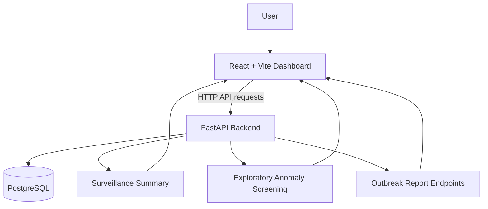

# System Architecture

## High-level request flow

## Components

- **Frontend:** renders the dashboard and requests backend data.
- **FastAPI:** exposes HTTP endpoints and API documentation.
- **PostgreSQL:** stores the currently loaded project datasets.
- **Surveillance summary:** aggregates loaded records by state, disease and observed reporting period.
- **Anomaly screening:** compares observations with a trailing historical baseline using a median/MAD approach.
- **Outbreak report endpoints:** provide India-related and global outbreak-report responses.

## Local development addresses

- Frontend: Vite's local URL, normally `http://localhost:5173`.
- Backend: `http://127.0.0.1:8000`.
- API documentation: `http://127.0.0.1:8000/docs`.

This diagram describes the current prototype at a high level. Confirm the implementation and endpoint contracts before using it as a deployment architecture.
